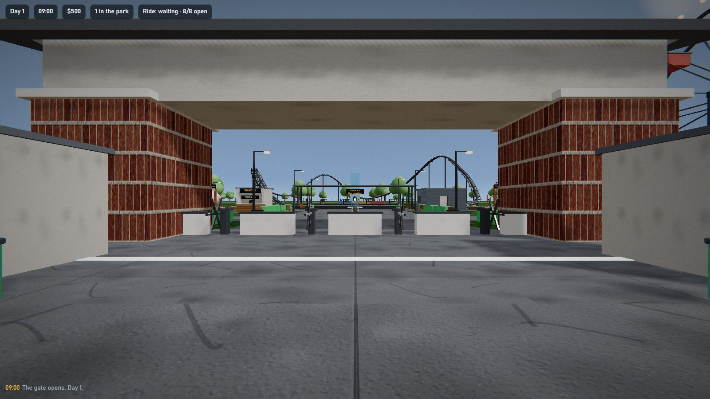
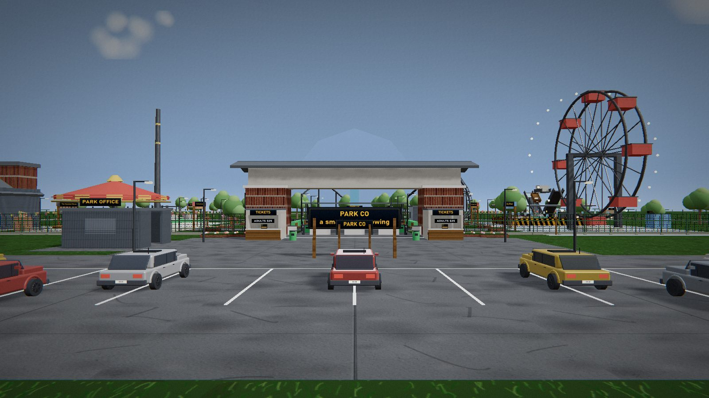
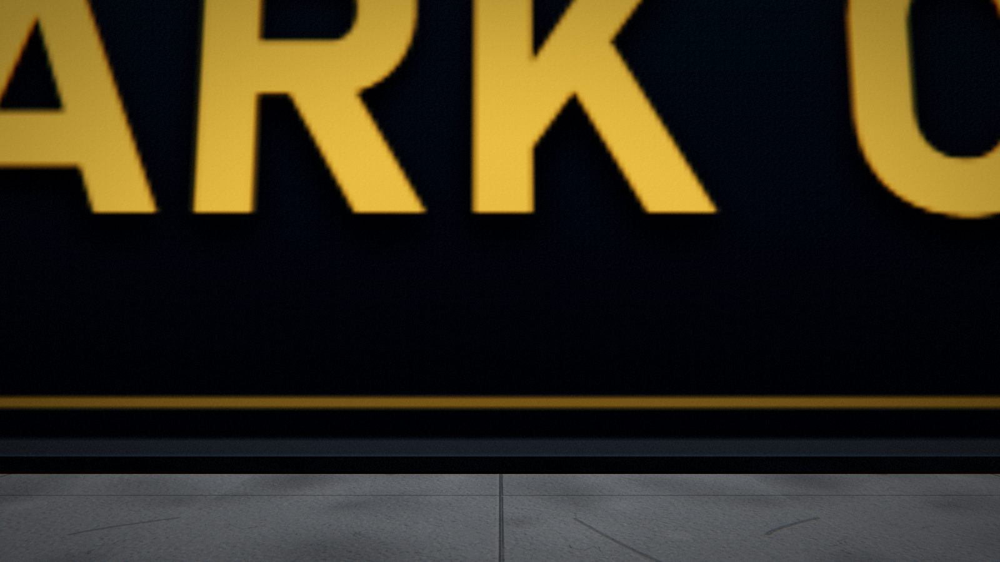
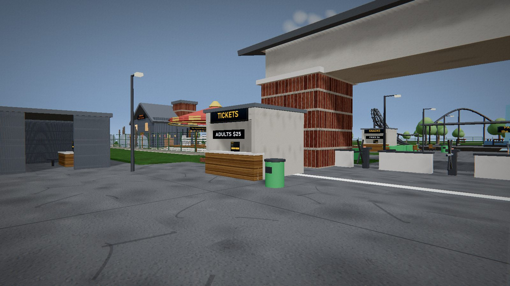
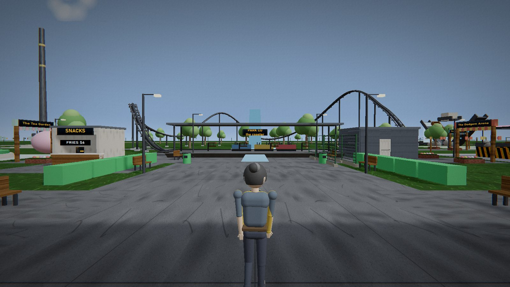
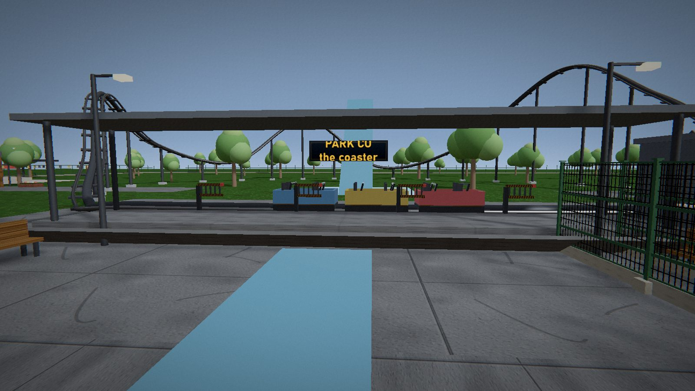
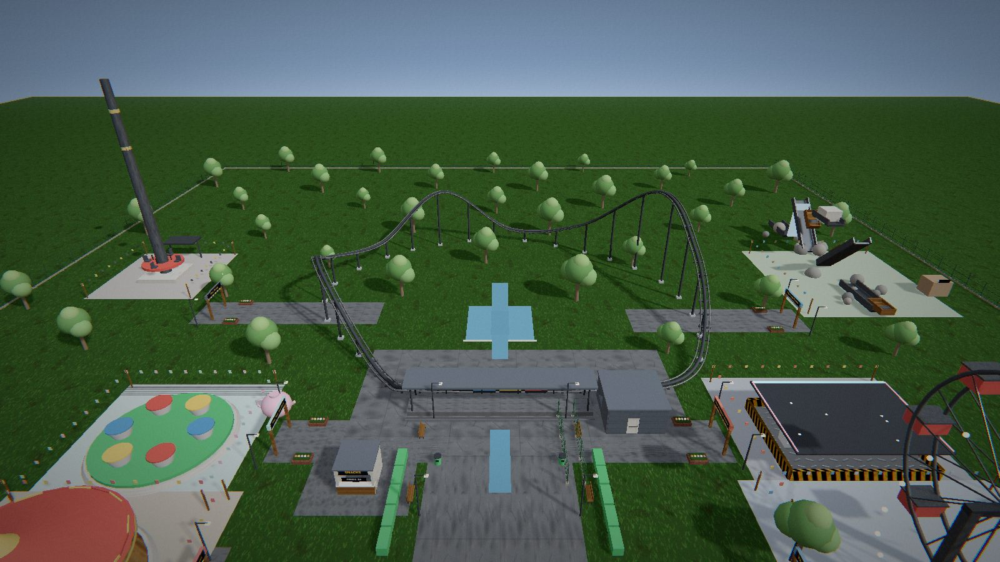
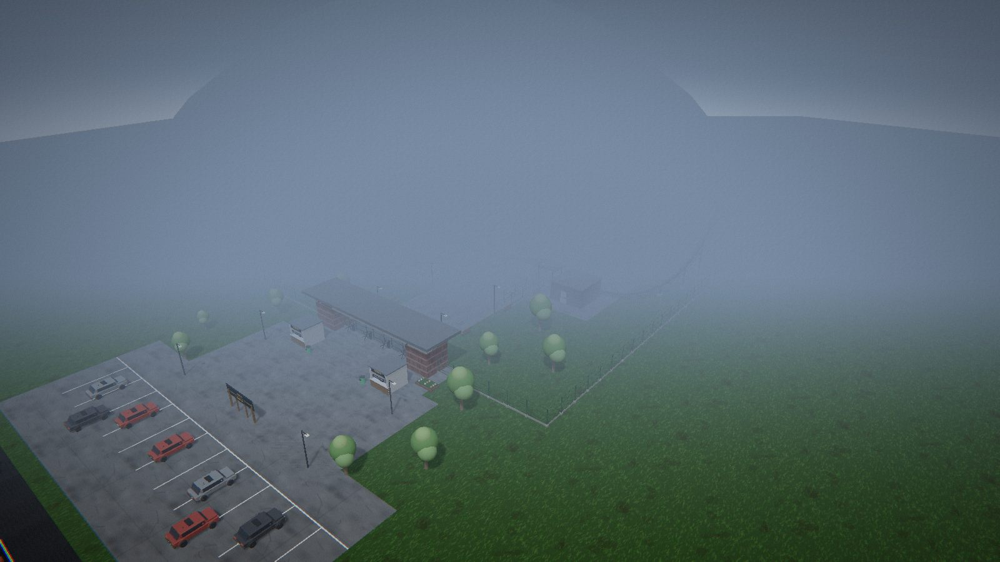

<!-- Project Header -->
<h1>
  
</h1>

<h3><em>Build. Operate. Grow.</em></h3>

  <strong>A fully code-built theme park simulator inspired by the charm of Efteling</strong>

  
  
  
  

  <a href="#-about">About</a> •
  <a href="#-features">Features</a> •
  <a href="#-controls">Controls</a> •
  <a href="#%EF%B8%8F-operations-guide">Operations Guide</a> •
  <a href="#-screenshots">Screenshots</a> •
  <a href="#-download">Download</a> •
  <a href="#-other-projects">Other Projects</a>

---

## ⚠️ Disclaimers

> [!IMPORTANT]
> - **Code-Only Creation:** This game is entirely made out of code — no 3D models were used in its creation.
> - **Powered by Co-Engine:** This project (along with [Depot Co](https://github.com/TheCodingDad-TisonK/Depot-Co), [Grow Co](https://github.com/TheCodingDad-TisonK/Grow-Co) & [Garage Co](https://github.com/TheCodingDad-TisonK/Garage-Co)) is built using [**Co-Engine**](https://github.com/TheCodingDad-TisonK/Co-Engine), a custom game engine created by me specifically for these types of projects.
> - **AI-Assisted Development:** AI is used to help shape and write my ideas into something beautiful. I've been coding with AI for over 2 years now, and it feels like it's paying off <3

---

## 📖 About

Take control of your very own theme park and watch it come to life. Inspired by the whimsical charm of **Efteling**, *Park Co* puts you in the hot seat as a park operator with complete authority over your establishment.

From selling tickets at the gate to dispatching coasters, running the railway, and keeping your guests happy — every aspect of park management falls into your capable hands. Earn XP as you serve your guests, level up, and unlock new opportunities as your park grows.

> **Time Scale:** 1 in-game hour = 75 real seconds  
> **Goal:** Keep the queues moving, the guests happy, and the park running smoothly!

---

## ✨ Features

<strong>🎡 Attractions & Transportation</strong>

- **20 Unique Rides** - A diverse collection of attractions to entertain your guests
- **Lindenburg Railway** - A lovingly crafted narrow-gauge steam train that loops around the entire park
- **5 Stations & 3 Level Crossings** - Fully operational railway infrastructure
- **Manual or Automatic** - Run rides on autopilot, or take the reins for a more hands-on experience

<strong>🏛️ Park Management</strong>

- **Gate Control** - Open and close your park on your own schedule
- **Economy System** - Set ticket prices, earn revenue, and manage your park's finances
- **Workforce Management** - Hire and fire up to 10 workers to help keep your park running
- **Power Management** - Full circuit breaker control with individual switches for all 20 rides
- **Lighting Control** - Toggle park lights and ride lights independently

<strong>🎮 Immersive Gameplay</strong>

- **Full Operator Control** - Every ride has its own detailed operator booth for complete control
- **Train Operations** - Dedicated train control panels at every railway station
- **Office & Tablet** - Manage your park from the HQ office PC, or use your portable tablet (`TAB`) anywhere in the park
- **Living Park** - Dynamic guests that wander, socialize on benches, and unfortunately litter (thankfully, sweepers are on duty!)
- **Beautiful Grounds** - Stroll through gardens featuring a flower clock, bandstand, windmill, and hedge maze
- **Extra Amenities** - Lindenburg Arena for shows, golf cart at HQ forecourt, and a bed in the office to skip time to 07:00

<strong>🛠️ Quality of Life</strong>

- **Third-Person Camera** (`C`) - Get a better view of your park
- **Fly Mode** (`F3`) - Soar through the sky for easy navigation and park overview
- **Dev Menu** (`F4`) - Debug and development tools
- **Level Progression** - Earn XP and level up to unlock new content

---

## 🎮 Controls

| Key | Action | Notes |
| :-- | :-- | :-- |
| `WASD` | Move | Standard movement |
| `SPACE` | Jump | |
| `E` | Interact / Board Rides | Your primary interaction key |
| `C` | Toggle 3rd Person Camera | Great for getting a better view |
| `TAB` | Open/Close Tablet | Quick park management on the go |
| `F3` | Toggle Fly Mode | Free cam movement |
| `F4` | Open Dev Menu | For development/testing |

---

## ⚙️ Operations Guide

### 🏢 Park Control Panel
Located throughout the park, the main park controls allow you to:

- `[GATE]` Open / Close the park entrance
- `[POWER]` Circuit breaker with individual switches for all 20 rides
- `[LIGHTING]` Control Park Lights & Ride Lights
- `[MANAGEMENT]` Set ticket prices, hire/fire staff, service the coaster

### 🎢 Ride Control Booth
Every attraction comes equipped with its own fully-featured operator booth:

| Control | Function |
| :-- | :-- |
| `OPERATOR KEY` | Enable/disable ride operation |
| `GATES` | Open and close boarding gates |
| `RESTRAINTS` | Lower/raise safety restraints |
| `DISPATCH` | Send the ride on its cycle |
| `E-STOP` | Emergency stop (use with caution!) |
| `TEST RUN` | Run a test cycle without guests |
| `AUTO / MANUAL` | Switch between automatic and manual operation |
| `MAINTENANCE` (`RUN` / `MAINT`) | Toggle maintenance mode for servicing |

> [!NOTE]
> **Manual Operation Sequence:** When running in MANUAL mode, follow the correct order:  
> `Gates Open` → `Guests Board` → `Gates Close` → `Restraints Down` → `Dispatch`

### 🚂 Train Control (Lindenburg Railway)
The narrow-gauge steam train running the Lindenburg loop can be controlled from dedicated **Train Control** panels at each of the 5 stations. Coordinate train movements with the 3 level crossings for safe operation!

---

## 📸 Screenshots

| | | |
| :--: | :--: | :--: |
|  |  |  |
|  |  |  |
|  |  | |

---

## 📥 Download

Get the latest version of Park Co from the [**Releases Page**](https://github.com/TheCodingDad-TisonK/Park-Co/releases).

1. Download `Park-Co-Setup-1.0.16.exe` from the latest release
2. Run the installer
3. Launch Park Co and start building your dream park!

---

## 🔗 Other Projects

Explore the rest of the **Co-Series** family:

| Project | Description |
| :-- | :-- |
| [**Co-Engine**](https://github.com/TheCodingDad-TisonK/Co-Engine) | The custom engine that powers the entire Co-Series |
| [**Depot Co**](https://github.com/TheCodingDad-TisonK/Depot-Co) | Logistics, hauling, and supply management |
| [**Grow Co**](https://github.com/TheCodingDad-TisonK/Grow-Co) | Farming, cultivation, and growth mechanics |
| [**Garage Co**](https://github.com/TheCodingDad-TisonK/Garage-Co) | Automotive tinkering and restoration |

---

**Made with code, creativity, and a little help from AI.**  
*© 2026 TheCodingDad-TisonK. All rights reserved.*

